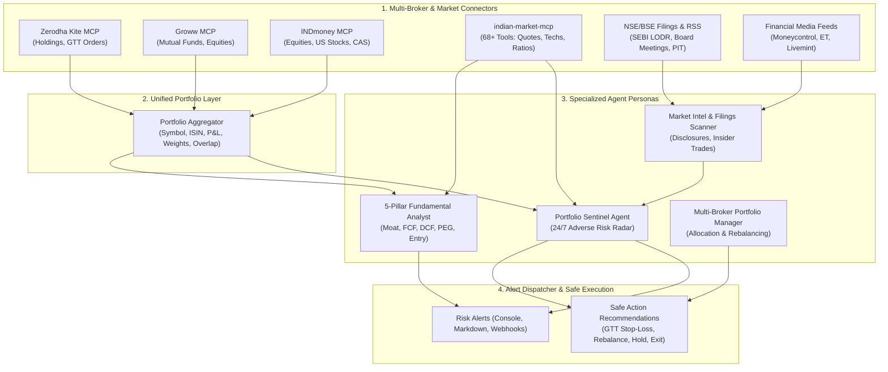

# 🛡️ Indian Market Agentic Trading, Portfolio Sentinel & Risk Intelligence Setup

An end-to-end multi-agent framework designed specifically for **Indian market (NSE/BSE, Mutual Funds, and ETFs)** investors. Built for long-term compounders and short/medium-term positional investors (**no day trading, no F&O**), this setup provides proactive heads-up monitoring for adverse market events, corporate filings, regulatory disclosures, and technical breakdowns across **Zerodha Kite, Groww, and INDmoney**.

Synthesizes structural patterns and best practices from:
- **`tradermonty/claude-trading-skills`**: Structured `SKILL.md` skill sets, technical indicator guardrails, and systematic research rigor.
- **`anthropics/financial-services`**: Institutional research notes, risk-weighted memos, and multi-broker portfolio abstraction.
- **`feiyuggg/openclaw-stock-analyzer`**: 5-pillar fundamental valuation framework (Moat, FCF, DCF, PEG, Margin of Safety) adapted for Indian equity WACC and growth dynamics.

---

## 🏛️ System Architecture



---

## 📂 Project Structure

```
agentic-trading-setup/
├── config/
│   ├── mcp_servers_config.json      # MCP config for Claude Desktop / Antigravity / Cursor
│   ├── risk_rules.json              # Risk thresholds, event triggers & severity taxonomy
│   ├── brokers_config.example.json  # Multi-broker connection settings
│   └── .env.example                 # Secrets & API credentials template
├── agents/
│   ├── portfolio_sentinel_agent.md   # Adverse event radar & early warning watchdog
│   ├── fundamental_valuation_agent.md# 5-Pillar Buffett/Duan Yongping fundamental analyst
│   ├── market_intel_agent.md         # NSE/BSE filings & media intelligence scanner
│   └── portfolio_manager_agent.md    # Multi-broker asset consolidator & rebalancing agent
├── skills/
│   ├── indian-portfolio-sentinel/    # SKILL.md for adverse event diagnostics
│   ├── indian-fundamental-valuation/ # SKILL.md for 5-pillar valuation analysis
│   ├── nse-corporate-filings/        # SKILL.md for SEBI LODR/PIT filing analysis
│   └── mf-etf-health-check/          # SKILL.md for MF manager change & ETF tracking error
├── src/
│   ├── models/
│   │   └── portfolio.py              # Pydantic/Dataclass schemas for holdings, events, alerts
│   ├── connectors/
│   │   ├── portfolio_aggregator.py   # Consolidates Kite, Groww, and INDmoney assets
│   │   ├── indian_market_connector.py# Interface to indian-market-mcp / quotes / indicators
│   │   ├── nse_filings_connector.py  # Exchange disclosures & corporate actions
│   │   └── news_sentiment_connector.py# News sentiment & adverse keyword classifier
│   ├── analyzers/
│   │   ├── adverse_event_analyzer.py # Multi-source downside risk engine
│   │   └── five_pillar_valuation.py  # 5-pillar valuation & DCF intrinsic value engine
│   └── alerts/
│       └── notifier.py               # Generates Rich terminal summaries & Markdown briefings
├── workflows/
│   ├── run_portfolio_sentinel.py     # Main portfolio monitoring & alerting runner
│   └── run_fundamental_review.py     # Stock-specific fundamental research runner
├── data/
│   └── mock_portfolio.json           # Sample real-world multi-broker Indian portfolio
├── pyproject.toml                    # Python project configuration (managed by uv)
└── README.md                         # Complete documentation
```

---

## 🔌 MCP (Model Context Protocol) Capability Deep Dive

### 1. Zerodha Kite MCP (`zerodha/kite-mcp-server` & Community Servers)
- **Hosted MCP Endpoint**: `https://mcp.kite.trade/mcp` (Direct zero-install remote connection).
- **Local MCP**: Official Go server or Node.js server (`Ritesh17rb/kite-mcp`).
- **Authentication**: Uses Kite Connect API key + API secret. Generates daily `access_token` via login redirect or automated TOTP.
- **Available Tools**:
  - `get_holdings`: Returns all demat equity, ETF, and SGB positions with quantity, average buy price, current LTP, and P&L.
  - `get_positions`: Positional trades and derivative contracts (filtered out in this setup).
  - `get_margins`: Cash balance, collateral margins, and payout status.
  - `place_gtt_order`: Sets Good-Till-Triggered orders (ideal for positional trailing stop-losses and dip-buying limits that stay valid for 1 year without daily renewal).
  - `get_quote`: Live market depth, OHLC, and circuit limits.

### 2. Groww MCP (`abhijeetmohanan/growwmcp` / `SharunIyer/indian-broker-mcp`)
- **Focus**: Mutual Funds (Direct Plans) and Direct Equities.
- **Authentication**: Groww session token or mobile auth bearer cookie.
- **Available Tools**:
  - `get_groww_portfolio`: Consolidates mutual fund folio numbers, NAVs, invested amounts, and SIP schedules.
  - `get_mf_scheme_details`: Queries fund manager name, category returns, and expense ratio (TER).

### 3. INDmoney MCP (`SharunIyer/indian-broker-mcp` / `VIckys-AI-Stuffs/indmoney`)
- **Focus**: Aggregated Net Worth, US Stocks, and CAS-tracked external folios.
- **Authentication**: JWT token / Device session ID.
- **Available Tools**:
  - `get_indmoney_networth`: Aggregates Indian stocks, tracked mutual funds (synced via CAMS/KFintech e-CAS), and US equities.

### 4. `afthabvp/indian-market-mcp` (Comprehensive Indian Market Intelligence)
- **Zero API keys needed**, runs directly with `uvx indian-market-mcp`.
- **68+ Tools** spanning:
  - **Equities**: Quotes, 52-week ranges, circuit limits, historical OHLCV.
  - **Technicals**: 200 EMA, 50 EMA, 20 EMA, RSI (14), Supertrend, MACD, Bollinger Bands.
  - **Corporate Filings**: Board meetings, dividend announcements, bonus/split records, quarterly results.
  - **Mutual Funds**: Scheme NAVs, historical returns, category averages.
  - **Institutional Flows**: Daily FII and DII net buying/selling in cash markets.

---

## 📰 Market News, Filings & Sentiment Sources

To avoid hallucination and capture adverse events early, this setup connects to 4 institutional data streams:

1. **NSE & BSE Corporate Disclosures (SEBI LODR Regulation 30)**:
   - Primary source of truth for price-sensitive announcements.
   - Monitors: Auditor resignations, forensic audit orders, tax/legal notices, credit rating downgrades (CRISIL/ICRA/CARE), promoter share pledging.
2. **Financial Media RSS Feeds**:
   - **Moneycontrol**: Corporate alerts, earnings concall summaries, management interviews.
   - **The Economic Times (ET Markets)**: Policy changes, macroeconomic updates, industry trends.
   - **Livemint**: Sectoral analyses, corporate governance reports.
3. **Regulatory Surveillance**:
   - SEBI Additional Surveillance Measure (ASM) & Graded Surveillance Measure (GSM) list additions.
   - SEBI Insider Trading (PIT) disclosures: Detects when promoters or directors sell shares in the open market.
4. **Mutual Fund & ETF Metrics (AMFI India)**:
   - Tracks star fund manager departures, scheme expense ratio hikes, and ETF tracking errors against benchmarks.

---

## 🚀 Quickstart & Execution

### 1. Prerequisites
Ensure you have `uv` and Python installed:
```bash
uv --version
python --version
```

### 2. Configure MCP Clients
Copy the configurations in `config/mcp_servers_config.json` into your AI client configuration (e.g. `claude_desktop_config.json` or Antigravity MCP settings).

### 3. Run the Portfolio Sentinel Workflow
Execute the automated risk diagnostic across your multi-broker portfolio:
```bash
python workflows/run_portfolio_sentinel.py
```
This inspects all holdings, runs adverse event checks, prints a summary to the console, and writes a detailed markdown report to `reports/sentinel_adverse_briefing.md`.

### 4. Run a 5-Pillar Fundamental Review on any Stock
Execute an in-depth fundamental, moat, FCF, and DCF valuation on any stock:
```bash
python workflows/run_fundamental_review.py HDFCBANK
python workflows/run_fundamental_review.py TATAMOTORS
python workflows/run_fundamental_review.py KAYNES
```

---

## 🔒 Safe Non-Day-Trading Guardrails
- **Human-in-the-Loop**: Trade orders are **never** executed autonomously without explicit user confirmation.
- **Order Types**: Uses Kite GTT (Good-Till-Triggered) orders rather than market orders to enforce disciplined entry prices and protective stop-losses.
- **Delivery Only**: Intraday leverage, shorting, and options contracts are blocked in configuration rules.
