# 🛡️ Indian Market Trading, Portfolio Sentinel & Risk Intelligence Plugin

[](plugin.json)
[](https://antigravity.google)
[](.mcp.json)
[](AGENTS.md)
[](plugin.yaml)
[](harnesses/openclaw_config.json)
[](AGENTS.md)
[](tests/)

An institutional-grade, multi-agent intelligence plugin designed specifically for **Indian capital market investors (NSE/BSE Equities, Exchange-Traded Funds, and AMFI Direct Mutual Funds)**. Built for long-term compounders, high-conviction value investors, and positional risk managers (**strictly NO F&O derivatives, NO intraday day trading**), this plugin delivers 24/7 proactive monitoring for negative market events, corporate governance anomalies, SEBI LODR disclosures, and valuation shifts across **Zerodha Kite, Groww, and INDmoney**.

Synthesizes architecture patterns from:
- **`tradermonty/claude-trading-skills`**: Modular `SKILL.md` skill packaging, technical indicator guardrails, and systematic research rigor.
- **`anthropics/financial-services`**: Multi-broker portfolio consolidation, institutional risk-weighted memos, and fiduciary audit trails.
- **`feiyuggg/openclaw-stock-analyzer`**: 5-pillar fundamental valuation framework (Moat, FCF, DCF, PEG, Margin of Safety) calibrated for Indian equity WACC and long-term GDP dynamics.

---

## 🏛️ Architecture Topology

```mermaid
flowchart TD
    subgraph MultiHarnessClients ["1. Client Execution Harnesses"]
        AGY["Antigravity IDE & CLI<br/>(Native Plugin Manifest)"]
        CLAUDE_CODE["Claude Code<br/>(Auto .mcp.json & CLAUDE.md)"]
        CODEX["OpenAI Codex / Cursor<br/>(Root AGENTS.md Standard)"]
        HERMES["Hermes Agent<br/>(plugin.yaml & __init__.py)"]
        CLAUDE_DESK["Claude Desktop<br/>(MCP Stdio / SSE Config)"]
        OPENCLAW["OpenClaw Runtime<br/>(Autonomous Agent Topology)"]
    end

    subgraph AgentPersonas ["2. Specialized Agent Layer"]
        SENTINEL["portfolio_sentinel<br/>(Early-Warning Risk Radar)"]
        ANALYST["fundamental_analyst<br/>(5-Pillar Moat & DCF Analyst)"]
        INTEL["market_intel<br/>(Market Data & Filings Orchestrator)"]
        MANAGER["portfolio_manager<br/>(Multi-Broker Asset Consolidator)"]
    end

    subgraph BrokerIngestion ["3. Broker Ingestion Layer (Read-Only)"]
        KITE["Zerodha Kite MCP<br/>(Equities, Demat Holdings)"]
        GROWW["Groww MCP<br/>(Direct Equities & Mutual Funds)"]
        INDM["INDmoney MCP<br/>(Equities, US Stocks, CAS Tracking)"]
    end

    subgraph MarketRouting ["4. Multi-Tier Market Data Hierarchy"]
        NSE_CM["Tier 1: NSE Live CM (`cmmkt/mcp`)<br/>(Official Exchange Tape & Depth)"]
        NSE_BHAV["Tier 1: NSE Bhavcopy (`bhavcopy/cm/mcp`)<br/>(5-Yr EOD & Delivery Math)"]
        IMM["Tier 2: indian-market-mcp<br/>(47k+ AMFI Schemes, FII/DII)"]
        DALAL["Forensic: DalalOS (`dalalos/mcp`)<br/>(BSE-XBRL Audits & Capex)"]
        SEC_EDGAR["Regulatory: SEC EDGAR (`sec-edgar`)<br/>(Audited 10-K/Q, 8-K for US Equities)"]
        OPENBB["Macro: OpenBB Platform (`openbb`)<br/>(Macro Data, Cross-Asset & Yields)"]
        ALPHA["Technical: Alpha Vantage<br/>(Pre-calculated RSI, MACD, BB)"]
        YFIN["Tier 3: yfinance-mcp (`yfmcp`)<br/>(Unauth Quotes & WebP Visuals)"]
    end

    subgraph PersistentMemory ["5. Persistent Investment Memory"]
        OBS["Obsidian Vault (`obsidian-mcp-server`)<br/>(Stock Theses, MF Audits, Risk Journals)"]
    end

    AGY --> AgentPersonas
    CLAUDE_CODE --> AgentPersonas
    CODEX --> AgentPersonas
    HERMES --> AgentPersonas
    CLAUDE_DESK --> AgentPersonas
    OPENCLAW --> AgentPersonas

    AgentPersonas --> MANAGER
    MANAGER --> KITE
    MANAGER --> GROWW
    MANAGER --> INDM

    AgentPersonas --> INTEL
    INTEL --> NSE_CM
    INTEL --> NSE_BHAV
    INTEL --> IMM
    INTEL --> DALAL
    INTEL --> ALPHA
    INTEL --> YFIN

    SENTINEL --> OBS
    ANALYST --> OBS
    MANAGER --> OBS
```



---

## 🎯 Supported Platforms & Asset Scope

| Platform / Broker | Asset Coverage | Connection Mode | Authentication Model |
| :--- | :--- | :--- | :--- |
| **Zerodha Kite** | Cash Equities, Gold & Index ETFs, SGBs | Read-only MCP (`mcp-remote`) | Kite Connect API Key + Session TOTP (Daily 06:00 IST expiry) |
| **Groww** | Direct Mutual Funds (AMFI), Cash Equities | Read-only MCP (`growwmcp`) | Mobile Bearer Token / Session Cookie |
| **INDmoney** | Indian Equities, US Stocks, CAMS/KFintech e-CAS MFs | Read-only MCP (SSE endpoint) | Web Session JWT / Secure Device ID |
| **Obsidian** | Local Markdown Vault (Theses, Funds, Alerts) | Local REST API MCP (`obsidian-mcp-server`) | Local REST API Key (`OBSIDIAN_API_KEY`) |

### Strict Asset Scope & Horizon Rules:
- **PERMITTED**: NSE/BSE Cash Market Delivery Equities, Listed ETFs (Nifty 50, Bank Nifty, Gold, International), AMFI Direct Mutual Funds (Growth Plans), and US Equities held via INDmoney.
- **STRICTLY PROHIBITED**:
  - ❌ **No Futures & Options (F&O)**: Zero derivatives, intraday leverage, or options writing.
  - ❌ **No Day Trading or Scalping**: Zero high-frequency or algorithmic intraday speculation.
  - ❌ **No Autonomous Live Order Execution**: Zero tools for executing live orders (`place_order`, `place_gtt_order`, `cancel_order`).

---

## ⚡ Multi-Tier Market Data Hierarchy & Fallback Matrix

To guarantee maximum availability and eliminate rate-limit disruptions during market hours, all market data requests follow a deterministic multi-tier routing architecture:

```
+---------------------------------------------------------------------------------------------------+
| Multi-Tier Resilient Routing Hierarchy                                                             |
+---------------------------------------------------------------------------------------------------+
| 1. Indian Equities Tape:                                                                          |
|    Tier 1: Official NSE Live CM (`cmmkt/mcp`) & NSE Bhavcopy (`bhavcopy/cm/mcp`)                  |
|    --> Tier 2: `indian-market-mcp` (68+ community market tools)                                    |
|    --> Tier 3: `yfinance-mcp` (Unauthenticated `.NS`/`.BO` quotes)                                |
+---------------------------------------------------------------------------------------------------+
| 2. Mutual Funds & ETFs:                                                                           |
|    Tier 1: `indian-market-mcp` (47,000+ AMFI schemes, NAV history, SIP XIRR)                      |
|    --> Tier 2: `yfinance-mcp` (Fund style box & underlying portfolio look-through)                |
+---------------------------------------------------------------------------------------------------+
| 3. Corporate Filings & Forensics:                                                                 |
|    Tier 1: Official NSE Corporate Announcements (SEBI LODR Reg 30 disclosures)                    |
|    --> Tier 2: `DalalOS` BSE-XBRL Filings (Capex, order book, auditor notes, BRSR)                 |
+---------------------------------------------------------------------------------------------------+
| 4. Technical Oscillators & Visuals:                                                               |
|    Tier 1: NSE Bhavcopy (`moving_average` server-side math)                                       |
|    --> Tier 2: `Alpha Vantage` (Pre-calculated RSI, MACD, Bollinger Bands)                        |
|    --> Tier 3: `yfinance-mcp` (Base64 WebP technical chart visual generation)                     |
+---------------------------------------------------------------------------------------------------+
```

### Detailed Fallback Specifications

| Data Domain | Tier 1 (Primary) | Tier 2 (Secondary) | Tier 3 (Fallback) | Failover Trigger & Handling |
| :--- | :--- | :--- | :--- | :--- |
| **Live Equity Tape & Depth** | `nse-cm-market` | `indian-market-mcp` | `yfinance-mcp` | Failover on HTTP 429, exchange timeout (>5s), or pre-open holiday session. |
| **Historical EOD & Delivery** | `nse-bhavcopy` | `indian-market-mcp` | `yfinance-mcp` | 5-year official Bhavcopy delivery volume. Failover if range > 5 years. |
| **Mutual Funds (47k AMFI)** | `indian-market-mcp` | Broker Ingestion NAV | `yfinance-mcp` | Direct scheme analytics. Log Render cold-start notice if initial latency > 10s. |
| **Corporate Filings (Indian)** | NSE Filings (Reg 30) | `dalalos` (BSE-XBRL) | Web Search / Portal | Material disclosures corroborated across both exchange sources. |
| **Corporate Filings (US Equities)** | `sec-edgar` (10-K, 10-Q, 8-K) | `yfinance-mcp` | Web Search / SEC EDGAR | Authoritative XBRL GAAP data for INDmoney US holdings. |
| **Macro & Cross-Asset Intelligence** | `openbb` (Platform unified) | `alpha-vantage` | `yfinance-mcp` | Standardize macro indicators, yields, and currencies. |
| **Technical Oscillators** | `nse-bhavcopy` | `alpha-vantage` | `yfinance-mcp` (WebP) | Always use server-side indicator computation to conserve token context. |

---

## 🔒 Core Operating Principles & Safety Guardrails

All agents operate under non-negotiable quantitative and behavioral guardrails codified in [`rules/AGENTS.md`](rules/AGENTS.md):

1. **Strictly Advisory Output (Zero Live Execution Tools)**:
   - Live order placement tools (such as `place_order`, `place_gtt_order`, and `cancel_order`) are **strictly prohibited and non-existent** in this plugin.
   - All portfolio recommendations (hedging levels, trailing stop levels, dip-buying tranches, rebalancing adjustments) are outputted as structured Markdown Advisory Cards.
   - Execution is exclusively performed manually by the human investor within their broker application.

2. **Mandatory Broker Authentication Gating**:
   - Zerodha Kite sessions expire daily at **06:00 AM IST**.
   - If Kite, Groww, or INDmoney credentials are unauthenticated or expired, the agent must **immediately halt execution** and guide the user through re-authentication.
   - Silent fallbacks to stale data or substituting real accounts with synthetic portfolios without user authorization is **strictly disallowed**.

3. **Corporate Action Price-Adjustment Check**:
   - Raw exchange price drops exceeding 20% on a single trading day can trigger false panic.
   - The agent must **cross-reference corporate actions** (`get_corporate_actions` / DalalOS) for stock splits, bonus share distributions, rights issues, or demergers on or near the ex-date.
   - If mathematically explained by an ex-action ratio (e.g. 1:1 bonus or 1:10 split), the agent automatically adjusts the cost basis, documents the corporate event, and suppresses false-alarm distress alerts.

4. **Survivorship Bias Guardrail**:
   - Strictly prohibit retrospective backtesting or equity universe screening using modern index constituents without point-in-time constituent adjustment.
   - Retrospective filtering without accounting for past delistings, demotions, or bankruptcies generates an artificial positive return drift.

5. **Token Optimization & Server-Side Indicator Computation**:
   - Agents never fetch massive uncompressed raw tick-by-tick OHLCV JSON dumps.
   - Indicator values (200 EMA, 50 EMA, 14 RSI, MACD, Bollinger Bands) are fetched using pre-computed server-side endpoints (`alpha-vantage` or `nse-bhavcopy`).
   - Summary statistics and holdings matrices are condensed into compact Markdown tables.
   - When visual validation of chart patterns or support/resistance shelves is needed, `yfinance-mcp` produces multimodal base64 WebP charts.

---

## ⚙️ Setup & Installation Guide

### Option 1: In Google Antigravity (Native Plugin)

1. Clone or place this repository into your workspace:
   ```bash
   git clone https://github.com/dotslash21/stonks-agent.git
   cd stonks-agent
   ```
2. Antigravity discovers plugins automatically via [`plugin.json`](plugin.json). To register the plugin in your global or local config, run:
   ```bash
   agy plugin install .
   ```
3. Verify that all 4 agents and 5 skills are loaded in the Antigravity Agent Pane.

---

### Option 2: In Claude Code (Turnkey)

This repository is pre-configured for **Claude Code** out-of-the-box:
1. Clone and enter the repository:
   ```bash
   git clone https://github.com/dotslash21/stonks-agent.git
   cd stonks-agent
   ```
2. **Auto-Discovery**: Claude Code automatically loads all 12 MCP servers via root [`.mcp.json`](.mcp.json) and reads project rules, advisory constraints, and test commands from root [`CLAUDE.md`](CLAUDE.md).
3. Export your broker and API keys in your shell:
   ```bash
   export ZERODHA_ACCESS_TOKEN="your_daily_token"
   export GROWW_AUTH_TOKEN="your_groww_token"
   export INDMONEY_API_TOKEN="your_indmoney_token"
   export ALPHA_VANTAGE_API_KEY="your_alpha_key"
   export DALALOS_API_KEY="your_dalalos_key"
   export SEC_EDGAR_USER_AGENT="StonksAgent/1.0 (investor@stonks-agent.local)"
   export OBSIDIAN_API_KEY="your_obsidian_key"
   export OBSIDIAN_VAULT_PATH="/path/to/vault"
   ```
4. Start Claude Code:
   ```bash
   claude
   ```

---

### Option 3: In OpenAI Codex & Cursor

OpenAI Codex, Cursor, and OpenAI CLI harnesses search for the agent instruction standard at the project root:
1. Root [`AGENTS.md`](AGENTS.md) is automatically ingested by Codex / Cursor agents as workspace instructions.
2. The rules establish mandatory broker authentication gating, zero live trade execution, corporate action price adjustments, and multi-tier data routing fallbacks.
3. Configure your MCP bridge or proxy using the canonical definitions in [`mcp_config.json`](mcp_config.json).

---

### Option 4: In Claude Desktop

1. Copy the pre-configured MCP definitions from [`harnesses/claude_desktop_config.json`](harnesses/claude_desktop_config.json) into your Claude Desktop configuration file:
   - **Windows**: `%APPDATA%\Claude\claude_desktop_config.json`
   - **macOS**: `~/Library/Application Support/Claude/claude_desktop_config.json`
   - **Linux**: `~/.config/Claude/claude_desktop_config.json`
2. Ensure authentication tokens (`INDMONEY_API_TOKEN`, `ALPHA_VANTAGE_API_KEY`, `OBSIDIAN_API_KEY`, `OBSIDIAN_VAULT_PATH`) are set in your environment.
3. Restart Claude Desktop.

---

### Option 5: In Hermes Agent

This repository functions natively as a **Hermes Agent plugin** via its root [`plugin.yaml`](plugin.yaml) and [`__init__.py`](__init__.py).

#### 1. Authoritative Installation Path
Install directly via the official Hermes CLI:
```bash
hermes plugins install https://github.com/dotslash21/stonks-agent
```
*(For local offline development, clone directly into your Hermes plugins directory: `git clone https://github.com/dotslash21/stonks-agent.git ~/.hermes/plugins/stonks-agent`)*

#### 2. Configure MCP Servers in Hermes
Merge the MCP definitions from [`harnesses/hermes_config.yaml`](harnesses/hermes_config.yaml) into your `~/.hermes/config.yaml` under `mcp_servers:`:
```yaml
# ~/.hermes/config.yaml excerpt
mcp_servers:
  zerodha-kite:
    command: "npx"
    args: ["-y", "mcp-remote", "https://mcp.kite.trade/mcp"]
  groww:
    command: "npx"
    args: ["-y", "mcp-remote@0.1.18", "https://mcp.groww.in/mcp", "52155"]
  indmoney:
    url: "https://mcp.indmoney.com/mcp"
    headers:
      Authorization: "Bearer ${INDMONEY_API_TOKEN}"
  nse-cm-market:
    command: "npx"
    args: ["-y", "mcp-remote", "https://mcp.nseindia.in/cmmkt/mcp"]
  nse-bhavcopy:
    command: "npx"
    args: ["-y", "mcp-remote", "https://mcp.nseindia.in/bhavcopy/cm/mcp"]
  indian-market-mcp:
    command: "uvx"
    args: ["indian-market-mcp"]
  dalalos:
    url: "https://mcp.dalalos.in/mcp"
  yfinance-mcp:
    command: "uvx"
    args: ["yfmcp"]
  alpha-vantage:
    url: "https://mcp.alphavantage.co/mcp"
    headers:
      Authorization: "Bearer ${ALPHA_VANTAGE_API_KEY}"
  obsidian:
    command: "npx"
    args: ["-y", "obsidian-mcp-server@3.7.2"]
    env:
      OBSIDIAN_API_KEY: "${OBSIDIAN_API_KEY}"
      OBSIDIAN_VAULT_PATH: "${OBSIDIAN_VAULT_PATH}"
```

#### 3. Hermes Slash Commands & Guardrails
- `/sentinel_audit [symbol]`: Triggers pre-market risk audit across broker holdings.
- `/valuation_audit [symbol]`: Performs 5-pillar fundamental valuation and moat analysis.
- `/mf_audit [scheme]`: Audits mutual funds and ETFs for TER creep, AUM bloat, and benchmark tracking error.
- `/market_status`: **Inspects live environment variables and tokens** (`ZERODHA_ACCESS_TOKEN`, `GROWW_AUTH_TOKEN`, `INDMONEY_API_TOKEN`, `OBSIDIAN_API_KEY`, `ALPHA_VANTAGE_API_KEY`) and reports connection readiness and session status.
- **Safety Guardrail Hook**: `pre_tool_call` automatically intercepts and blocks any execution tool (`place_order`, `place_gtt`, `cancel_order`, `square_off`, `placeOrder`, etc.), guaranteeing 100% read-only operation across snake_case, camelCase, and kebab-case tool names.

---

### Option 6: In OpenClaw

1. Point your OpenClaw agent deployment manifest to [`harnesses/openclaw_config.json`](harnesses/openclaw_config.json):
   ```bash
   openclaw plugin register ./harnesses/openclaw_config.json
   ```
2. The runtime config registers all 4 agent personas, 5 skill paths, and all 10 MCP server definitions.

---

### Option 7: Configuring Obsidian Investment Memory

1. Open your **Obsidian** investment research vault.
2. Install and enable the community plugin: **Local REST API** (`coddingtonbear/obsidian-local-rest-api`).
3. Under plugin settings:
   - Note the port (default: `27124`).
   - Copy the generated **API Key** or set your custom token.
4. Export the key in your environment or set it in [`mcp_config.json`](mcp_config.json):
   ```json
   "env": {
     "OBSIDIAN_API_KEY": "your_generated_api_key_here"
   }
   ```
5. Ensure your vault contains the following folders to match the template workflows:
   - `Investing/Theses/` (e.g. `Investing/Theses/HDFCBANK-thesis.md`)
   - `Investing/Funds/` (e.g. `Investing/Funds/2026-H1-MF-Health-Check.md`)
   - `Investing/Alerts/` (e.g. `Investing/Alerts/YYYY-MM-DD-SYMBOL-alert.md`)

---

## 🤖 Agent Personas & Catalog

| Agent Manifest | Display Name | Core Purpose & Responsibilities | Bound Skills |
| :--- | :--- | :--- | :--- |
| [`agents/portfolio_sentinel.md`](agents/portfolio_sentinel.md) | **Portfolio Sentinel** | 24/7 early warning risk watchdog. Detects price-sensitive corporate filings, auditor resignations, forensic audit triggers, promoter share pledging, and technical 200 EMA / 52-week low breakdowns. | `portfolio-sentinel`, `nse-corporate-filings`, `obsidian-portfolio-memory` |
| [`agents/fundamental_analyst.md`](agents/fundamental_analyst.md) | **Fundamental Analyst** | Buffett/Duan 5-Pillar equity valuation analyst. Performs moat scoring, owner earnings / FCF computation, DCF intrinsic value modeling with Indian WACC (11.5–13.5%), and BSE-XBRL forensic audits. | `fundamental-valuation`, `nse-corporate-filings`, `obsidian-portfolio-memory` |
| [`agents/market_intel.md`](agents/market_intel.md) | **Market Intel Orchestrator** | Multi-tier market data router. Fetches official NSE live CM tape, historical Bhavcopy delivery volumes, 47k AMFI fund NAVs, and Alpha Vantage technical indicators with automatic fallback failover. | `nse-corporate-filings`, `mf-etf-health-check` |
| [`agents/portfolio_manager.md`](agents/portfolio_manager.md) | **Multi-Broker Portfolio Manager** | Aggregates and reconciles holdings across Zerodha Kite, Groww, and INDmoney. Enforces broker authentication gating, detects inter-fund portfolio overlap, and generates rebalancing recommendations. | `mf-etf-health-check`, `portfolio-sentinel`, `obsidian-portfolio-memory` |

---

## 🧠 Specialized Skill Packages Catalog

| Skill Package | Instructions File | Capabilities & Analytical Modules |
| :--- | :--- | :--- |
| **`portfolio-sentinel`** | [`skills/portfolio-sentinel/SKILL.md`](skills/portfolio-sentinel/SKILL.md) | 5-tier adverse risk taxonomy (Governance, Solvency, Regulatory, Technical, Macro). Automatic corporate action adjustment logic for stock splits and bonus distributions. |
| **`fundamental-valuation`** | [`skills/fundamental-valuation/SKILL.md`](skills/fundamental-valuation/SKILL.md) | 5-Pillar valuation framework: Moat durability, Free Cash Flow yield, 2-stage DCF intrinsic valuation model, PEG ratio growth analysis, and Margin of Safety assessment. |
| **`nse-corporate-filings`** | [`skills/nse-corporate-filings/SKILL.md`](skills/nse-corporate-filings/SKILL.md) | SEBI LODR Regulation 30 event classifier. Auditor resignation triggers, forensic audits, promoter share pledging spikes, and SEBI PIT insider trading disclosures. |
| **`mf-etf-health-check`** | [`skills/mf-etf-health-check/SKILL.md`](skills/mf-etf-health-check/SKILL.md) | AMFI scheme analytics for 47,000+ mutual funds. Fund manager transition radar, AUM bloat monitoring, expense ratio (TER) creep detection, and ETF tracking error audits. |
| **`obsidian-portfolio-memory`** | [`skills/obsidian-portfolio-memory/SKILL.md`](skills/obsidian-portfolio-memory/SKILL.md) | Vault note creation and updates via `obsidian-mcp-server`. Populates structured YAML frontmatter for equity investment theses, fund reviews, and risk alert incident journals. |

---

## 📝 Obsidian Note Templates Catalog

Located in [`templates/obsidian/`](templates/obsidian/):

1. [`templates/obsidian/stock-thesis-template.md`](templates/obsidian/stock-thesis-template.md):
   - Structured template for equity investment theses.
   - Captures 5-pillar fundamental analysis, DCF fair value calculations, key risks, conviction ratings, and review triggers.
2. [`templates/obsidian/mf-etf-review-template.md`](templates/obsidian/mf-etf-review-template.md):
   - Structured template for semi-annual mutual fund and ETF health checks.
   - Tracks manager tenure, AUM growth, tracking error against benchmark, portfolio overlap, and style box drift.
3. [`templates/obsidian/risk-alert-journal-template.md`](templates/obsidian/risk-alert-journal-template.md):
   - Incident response journal for material risk events.
   - Logs severity ratings (CRITICAL / HIGH / MEDIUM / LOW), verified corporate disclosures, technical damage, and human-in-the-loop action plans.

---

## 💡 Practical Workflows & Example Prompts

### Workflow 1: Pre-Market Multi-Broker Risk Audit
Audit all equity holdings across Zerodha Kite and Groww before market open (09:15 AM IST):

```text
Run a comprehensive pre-market risk audit across my Zerodha Kite and Groww portfolios for any adverse events, corporate filings, or technical breakdowns. If any broker session is expired, prompt me with re-authentication steps. Check whether any sharp price changes are attributable to corporate actions before flagging alerts.
```

**Execution Path**:
1. `portfolio_manager` checks Kite (session valid post-06:00 IST) and Groww authentication.
2. Ingests holdings and passes them to `portfolio_sentinel`.
3. `market_intel` queries official NSE filings and Bhavcopy prices.
4. If any holding dropped >10%, `corporate_action_check` verifies ex-dates for bonuses or splits.
5. Critical governance flags are outputted as structured Markdown Advisory Cards and logged to Obsidian under `Investing/Alerts/` (e.g. `Investing/Alerts/YYYY-MM-DD-SYMBOL-alert.md`) via `obsidian-portfolio-memory`.

---

### Workflow 2: 5-Pillar Fundamental & Moat Valuation
Evaluate fair value and competitive durability on a core holding:

```text
Perform an in-depth 5-pillar fundamental valuation and moat analysis on HDFCBANK and KAYNES. Calculate DCF fair value using Indian WACC, audit capex disclosures against BSE-XBRL filings via DalalOS, and generate an investment thesis in my Obsidian vault.
```

**Execution Path**:
1. `fundamental_analyst` retrieves XBRL filings via `dalalos` and historical delivery data via `nse-bhavcopy`.
2. Evaluates the 5 pillars: Moat durability, Free Cash Flow yield, 2-stage DCF, PEG ratio, and Margin of Safety.
3. Calculates intrinsic value factoring in terminal growth rates (5–6% for India).
4. Populates [`templates/obsidian/stock-thesis-template.md`](templates/obsidian/stock-thesis-template.md) and writes it into `Investing/Theses/HDFCBANK-thesis.md` in Obsidian.

---

### Workflow 3: Direct Mutual Fund & ETF Health Check
Audit mutual fund holdings for manager departures, fee creep, and asset overlap:

```text
Audit my mutual fund holdings on Groww and INDmoney (Parag Parikh Flexi Cap Fund and Quant Small Cap Fund). Inspect fund manager changes, TER changes over the past year, AUM concentration, and portfolio overlap against NIFTYBEES. Log findings in Obsidian.
```

**Execution Path**:
1. `portfolio_manager` aggregates MF folios from Groww and INDmoney.
2. Invokes `mf-etf-health-check` skill using `indian-market-mcp` (AMFI data).
3. Compares top 10 portfolio constituents against NIFTYBEES for duplicate exposure.
4. Writes audit note to `Investing/Funds/2026-H1-MF-Health-Check.md` using [`templates/obsidian/mf-etf-review-template.md`](templates/obsidian/mf-etf-review-template.md).

---

### Workflow 4: Offline Simulation with Mock Portfolio
Test the entire intelligence suite safely using the bundled sample portfolio:

```text
Simulate a portfolio audit using examples/mock_portfolio.json. Walk through each holding across Zerodha Kite, Groww, and INDmoney, evaluate market data fallbacks, and demonstrate how a bonus split on TATAMOTORS or governance alert on KAYNES is processed.
```

**Holdings included in [`examples/mock_portfolio.json`](examples/mock_portfolio.json)**:
- **Equities**: `HDFCBANK`, `RELIANCE`, `TATAMOTORS`, `TCS`, `INFY`, `KAYNES`
- **ETFs**: `NIFTYBEES`, `GOLDBEES`, `MON100`
- **Direct Mutual Funds**: `PARAG_PARIKH_FLEXI_CAP`, `QUANT_SMALL_CAP`, `NIPPON_INDIA_SMALL_CAP`

---

## 🧪 Verification & Test Suite

The repository includes a comprehensive, automated test suite in [`tests/test_plugin_verification.py`](tests/test_plugin_verification.py) verifying all plugin schemas, safety rules, and configs.

Run the test suite:
```bash
python -m unittest discover tests
```

### Verification Suite Coverage (15/15 Tests Passing):
1. `test_plugin_manifest_validity`: Validates `plugin.json` schema, author, version, and prompt list.
2. `test_mcp_config_validity`: Verifies presence and syntax for all 10 MCP servers in `mcp_config.json`.
3. `test_no_execution_tools_prohibition`: Enforces 0 live order placement or cancellation tools (`place_order`, `place_gtt`, `cancel_order`, etc.) across all agent manifests, skills, and rule files.
4. `test_corporate_action_rule_enforcement`: Confirms explicit corporate action verification rules exist in `portfolio_sentinel.md` and `portfolio-sentinel`.
5. `test_broker_auth_gate_enforcement`: Confirms mandatory broker auth gating in `rules/AGENTS.md` and `portfolio_manager.md`.
6. `test_all_skills_and_agents_exist`: Verifies YAML frontmatter (`name`, `description`/`role`) for all 5 skills and 4 agents.
7. `test_mock_portfolio_schema`: Validates `examples/mock_portfolio.json` structure, holdings array, and symbols.
8. `test_obsidian_templates_exist`: Validates all 3 Obsidian markdown templates exist and are non-empty.
9. `test_harness_configs_validity`: Validates JSON schema and server configurations in `claude_desktop_config.json` and `openclaw_config.json`.
10. `test_multi_harness_root_files`: Validates root `.mcp.json` (Claude Code), root `CLAUDE.md`, and root `AGENTS.md` (OpenAI Codex / Cursor).
11. `test_plugin_yaml_exists_and_conforms`: Validates Hermes Agent plugin manifest (`plugin.yaml`) metadata, skills, hooks, and environment dependencies.
12. `test_init_py_registration`: Verifies `register(ctx)` registers skills, hooks, and slash commands.
13. `test_guardrail_hook_blocks_forbidden_tools`: Verifies pre_tool_call hook blocks execution tools across snake_case, camelCase, kebab-case, GTT, and square-off variants while allowing read-only inspection tools.
14. `test_slash_command_handlers`: Verifies slash commands handle arguments and `None` gracefully without crashing.
15. `test_hermes_config_yaml_validity`: Validates all 10 MCP servers and auth headers in `harnesses/hermes_config.yaml`.

---

## ⚖️ Legal & SEBI Compliance Disclaimer

> [!IMPORTANT]
> **Advisory Nature**: This software is an informational research and educational tool. It is **not** a registered investment advisory service under SEBI (Investment Advisers) Regulations, 2013, nor a portfolio management service under SEBI (Portfolio Managers) Regulations, 2020.
> 
> **Zero Automated Execution**: This plugin does **not** execute trades, manage funds, or hold custody of assets. All analytical outputs, risk scores, fair values, and alerts are strictly advisory. Users are solely responsible for conducting independent due diligence and executing investment decisions manually through their authorized SEBI-registered stockbrokers.
