# Design Document: Indian Market Portfolio Sentinel & Trading Plugin

**Date**: 2026-11-01  
**Status**: Revised Draft (Integrating Research Insights: Multi-Tiered Market Data, Fallback Routing & Defensive Guardrails)  
**Type**: Multi-Harness AI Agent Plugin  
**Target Harnesses**: Antigravity, Claude Desktop / Claude Code, OpenClaw, Cursor  

---

## 1. Intent and The Why
Retail investors in the Indian financial markets (holding direct equities, ETFs, and direct mutual funds across Zerodha Kite, Groww, and INDmoney) lack a unified, proactive risk radar. Market shocks, forensic audits, promoter pledge invocations, auditor resignations, and credit downgrades frequently destroy portfolio capital before retail investors can react.

Rather than building an independent, brittle Python execution runtime or standalone scheduler, the objective is to build a **modular, distributable AI Agent Plugin** that plugs directly into existing AI harnesses (Antigravity, Claude Desktop/Code, OpenClaw, Cursor). The AI harness orchestrates the reasoning and interaction, while the plugin provides:
1. **Multi-Broker Portfolio Ingestion**: Pre-configured MCP connections to trading platforms (Zerodha Kite, Groww, INDmoney) with strict authentication enforcement.
2. **Resilient, Multi-Tiered Market Data Architecture**: Ground-truth primary exchange endpoints (Official NSE Bhavcopy and Live CM Snapshot) backed by multi-asset aggregators (`indian-market-mcp`), forensic regulatory servers (`DalalOS`), and resilient global fallbacks (`yfinance-mcp`, `Alpha Vantage`).
3. **Persistent Investment Memory**: Portfolio journaling, stock theses, and adverse alert logs powered by Obsidian MCP (`obsidian-mcp-server`).
4. **Domain-Expert Agents & Defensive Guardrails**: Specialized personas enforcing strict risk models, 5-pillar fundamental valuations, SEBI LODR Reg 30 filing audits, corporate action price-adjustment checks, and token-optimized serialization.

---

## 2. Goals, Non-Goals, and Anti-Goals

### Goals
- **Multi-Broker MCP Abstraction**: Enable seamless inspection of user holdings across Zerodha Kite, Groww, and INDmoney using official/standard MCP endpoints without custom scraper code.
- **Strict Authentication Enforcement (No Silent Fallbacks for Broker Auth)**: If any required broker (Kite, Groww, INDmoney) is unauthenticated or its session has expired (e.g., Kite daily session token expiring at 6:00 AM IST), the agent **must explicitly trigger the authentication flow** and guide the user through re-authentication, rather than silently ignoring the broker or falling back.
- **Resilient, Multi-Tiered Market Data with Automated Fallbacks**:
  - **Tier 1 (Authoritative Primary)**: Official National Stock Exchange of India MCP endpoints (`nse-cm-market` for near-real-time live market tape/breadth; `nse-bhavcopy` for 5-year official EOD closing prices and delivery volumes).
  - **Tier 2 (Multi-Asset Specialist)**: `indian-market-mcp` for 47,000+ AMFI mutual fund schemes (NAVs, rolling returns, Sharpe, Sortino, SIP XIRR), all NSE ETFs, and institutional FII/DII daily net flows.
  - **Tier 3 (Forensic Filing & XBRL Specialist)**: `DalalOS` for cited extractions of official BSE-XBRL filings, capex commitments, order books, and BRSR governance disclosures.
  - **Tier 4 (Resilient Fallbacks & Indicators)**: `yfinance-mcp` (primary unauthenticated fallback for equity quotes via `.NS`/`.BO` and global ETF fund look-through) and `Alpha Vantage MCP` (server-side pre-calculated indicators: RSI, MACD, Bollinger Bands, VWAP to prevent LLM context exhaustion and arithmetic errors).
- **Corporate Action Price-Adjustment Safeguards**: Agents must cross-reference corporate actions (splits, bonuses, demergers, rights issues) before computing multi-month returns or flagging sudden nominal price drops, eliminating false-alarm crash hallucinations caused by raw Bhavcopy settlement prices.
- **Context Window & Token Optimization**: Enforce server-side indicator computation, compact markdown/CSV table serialization, and optional base64 WebP visual charting to conserve model attention and token budgets.
- **Strictly Advisory Recommendations**: All alerts, risk warnings, and GTT parameters are presented as structured, advisory markdown cards in chat and Obsidian notes for the user to review and execute manually.
- **Persistent Thesis & Memory Store in Obsidian**: Automatically create and update stock theses, mutual fund review notes, and risk alert journals in the user's Obsidian vault via `obsidian-mcp-server`.
- **Early-Warning Adverse Event Radar**: Monitor official NSE/BSE corporate filings (SEBI LODR Reg 30), technical trend breakdowns (200 EMA / RSI 14), and media news to generate actionable, risk-weighted alerts.
- **Deep 5-Pillar Fundamental Valuation**: Screen Indian equities on RoCE/RoE, Moat durability, Clean Governance (Pledged shares < 10%), Debt safety (Debt/Equity < 1.0), and DCF intrinsic value with margin of safety.
- **Mutual Fund & ETF Health Watchdog**: Monitor star fund manager departures, AUM bloat, expense ratio creeps, and ETF tracking errors (> 0.5%).
- **Multi-Harness Portability**: Ship standard `plugin.json` and `mcp_config.json` for Antigravity, accompanied by drop-in config manifests for Claude Desktop and OpenClaw.
- **Codebase Clean-Up & Salvage**: Salvage all existing domain intelligence (prompts, risk rules, valuation models, schemas) from the previous iteration, and cleanly remove the independent Python runtime harness (`src/` and `workflows/`).

### Non-Goals
- **No Standalone Application Execution**: No command-line Python scripts or custom runner executables. The user interacts through conversational AI agents or harness schedules.
- **No Web Backend / Database**: No Postgres, SQLite, or Redis. Portfolio state is fetched on demand via Broker MCPs, and persistent notes/memory live in Obsidian.

### Anti-Goals (Strict Guardrails)
- **STRICTLY NO Autonomous Order Execution**: All trading actions are strictly advisory. No order execution tools (like `place_order` or `place_gtt_order`) are bound to agents.
- **STRICTLY NO Intraday Scalping or Day Trading**: Focus exclusively on long-term wealth compounding and medium-term positional delivery investments.
- **STRICTLY NO Futures & Options (F&O)**: Derivatives trading is explicitly prohibited.

---

## 3. Constraints & Operating Boundaries
- **Platform**: Cross-platform (Windows / macOS / Linux) AI plugin structure.
- **Execution Mode**: Conversational on-demand by default across all harnesses (e.g., *"Run pre-market portfolio audit"*), with optional cron schedule templates for harnesses that support background automations (Antigravity and OpenClaw).
- **Authentication Policy**:
  - **Brokers**: Strict gating. If any designated broker is unauthenticated, the agent halts and surfaces an authentication card / interactive instruction. Mock portfolio data (`examples/mock_portfolio.json`) is strictly for deliberate test simulations when the user explicitly requests demo mode.
  - **Market Data Feeds**: Graceful fallback routing. If an official exchange feed or specialist endpoint is unavailable or rate-limited, the agent logs a non-blocking diagnostic and routes to the specified secondary fallback without halting the workflow.
- **Supported MCP Transports**:
  - `zerodha-kite`: `npx -y mcp-remote https://mcp.kite.trade/mcp`
  - `groww`: `npx -y mcp-remote@0.1.18 https://mcp.groww.in/mcp 52155`
  - `indmoney`: `https://mcp.indmoney.com/mcp`
  - `nse-cm-market`: `https://mcp.nseindia.in/cmmkt/mcp` (Streamable HTTP / SSE)
  - `nse-bhavcopy`: `https://mcp.nseindia.in/bhavcopy/cm/mcp` (Streamable HTTP / SSE)
  - `indian-market-mcp`: `uvx indian-market-mcp` (or remote `https://indian-market-mcp-wweh.onrender.com/mcp`)
  - `dalalos`: `https://mcp.dalalos.in/mcp` (Streamable HTTP, free tier 10,000 monthly credits)
  - `yfinance-mcp`: `uvx yfmcp` (or `npx yfinance-mcp-ts`)
  - `alpha-vantage`: `https://mcp.alphavantage.co/mcp`
  - `obsidian`: `npx -y obsidian-mcp-server@3.7.2` (Local REST API with API key `ec7a0921...`)

---

## 4. Multi-Tiered Market Data Architecture & Fallback Topology

To guarantee high availability, analytical depth, and mathematical fidelity across domestic and international assets, the plugin establishes a segregated multi-server routing topology:

```mermaid
flowchart TD
    subgraph ClientLayer["AI Harness & Client Layer"]
        User["User / Investor Prompt"]
        Orchestrator["Portfolio Sentinel / Manager Agent"]
    end

    subgraph BrokerLayer["Broker Portfolio Ingestion (Strict Auth Gate)"]
        Kite["Zerodha Kite MCP"]
        Groww["Groww MCP"]
        INDmoney["INDmoney MCP"]
    end

    subgraph DataRouting["Market Data & Analytics Routing Engine"]
        direction TB
        subgraph DomainEquities["1. Indian Equities & Market Tape"]
            E_Primary["Primary: Official NSE CM Live & Bhavcopy\n(Quotes, 5yr EOD, Breadth, Moving Avg)"]
            E_FB1["Fallback 1: Indian Market MCP (afthabvp)\n(NSE/BSE Quotes, Candlestick Scans)"]
            E_FB2["Fallback 2: yfinance-mcp (.NS / .BO)\n(Unauthenticated Global Tape)"]
        end

        subgraph DomainMF["2. Mutual Funds & ETFs"]
            MF_Primary["Primary: Indian Market MCP (afthabvp)\n(47k AMFI Schemes, NAVs, SIP XIRR, FII/DII)"]
            MF_FB["Fallback / Style Look-Through: yfinance-mcp\n(Sector weights, Morningstar style box, credit quality)"]
        end

        subgraph DomainGov["3. Corporate Filings, XBRL & Governance"]
            Gov_Primary["Primary: Official NSE Filings & SEBI LODR Reg 30\n(Material events, board meetings)"]
            Gov_FB["Forensic Deep-Dive: DalalOS MCP\n(BSE-XBRL filings, capex, order books, BRSR)"]
        end

        subgraph DomainTechnicals["4. Technical Indicators & Visual Charts"]
            Tech_Primary["Primary: Server-Side Math in Bhavcopy\n(Built-in moving averages)"]
            Tech_FB["Multi-Indicator Specialist: Alpha Vantage MCP\n(50+ indicators: RSI, MACD, VWAP, Bollinger Bands)"]
            Tech_Visual["Multimodal Vision: yfinance-mcp\n(Base64 WebP technical chart renders)"]
        end
    end

    subgraph MemoryLayer["Persistent Investment Memory"]
        Obsidian["Obsidian Vault via obsidian-mcp-server\n(Theses, MF Audits, Risk Alert Journal)"]
    end

    User --> Orchestrator
    Orchestrator --> BrokerLayer
    BrokerLayer --> Orchestrator
    Orchestrator --> DataRouting
    E_Primary -.->|Fail / Timeout| E_FB1 -.->|Fail / Timeout| E_FB2
    MF_Primary -.->|Cross-asset / Fail| MF_FB
    Gov_Primary -.->|Deep XBRL audit| Gov_FB
    Tech_Primary -.->|Deep indicators| Tech_FB
    Tech_FB -.->|Visual reasoning| Tech_Visual
    DataRouting --> Orchestrator
    Orchestrator --> Obsidian
```



### Domain-by-Domain Routing & Fallback Matrix

| Operational Domain | Primary Source (Tier 1) | Secondary / Fallback Source (Tier 2/3) | Trigger Condition for Fallback | Primary Asset Scope |
| :--- | :--- | :--- | :--- | :--- |
| **Indian Equities (Live Quotes & Tape)** | **NSE CM Live Snapshot** (`mcp.nseindia.in/cmmkt/mcp`) | **Indian Market MCP** (`afthabvp`) &rarr; **yfinance-mcp** (`<SYMBOL>.NS`) | Primary endpoint timeout (>5s), connection refused, or trading holiday closure. | NSE listed cash equities, sectoral indices, SME series. |
| **Indian Equities (Historical EOD & Delivery)** | **NSE Bhavcopy** (`mcp.nseindia.in/bhavcopy/cm/mcp`) | **Indian Market MCP** &rarr; **yfinance-mcp** | Query date exceeds 5-year rolling window, single-call window >3 months, or server error. | 3,500+ NSE equities, historical closing prices, delivery volumes. |
| **Mutual Funds (AMFI NAVs & Schemes)** | **Indian Market MCP** (`afthabvp/indian-market-mcp`) | **Groww MCP / INDmoney MCP** (holdings NAV) &rarr; **yfinance-mcp** | Public Render cold-start delay (>10s) or missing unlisted scheme identifier. | 47,000+ direct & regular AMFI MF schemes, SIP XIRR, Sharpe, Sortino. |
| **ETF Basket & Look-Through** | **Indian Market MCP** (`afthabvp`) | **narumiruna/yfinance-mcp** (`yfinance_get_fund_data`) | Need detailed sector allocation breakdown, bond credit rating, or Morningstar style box. | All NSE ETFs (Nifty 50, Gold, Bank, Debt, Global feeders). |
| **Corporate Filings & Material Disclosures** | **NSE Filings Feed** (SEBI LODR Reg 30) | **DalalOS MCP** (`mcp.dalalos.in/mcp`) | Comprehensive XBRL balance sheet verification, capex tracking, or management order book analysis. | NSE/BSE listed equities, regulatory filings, audited disclosures. |
| **Technical Indicators & Oscillators** | **NSE Bhavcopy** (`moving_average`) | **Alpha Vantage MCP** (RSI, MACD, VWAP) &rarr; **yfinance-mcp** (WebP Charts) | Need indicators beyond basic moving averages (e.g. RSI 14, MACD, Bollinger Bands) without raw JSON math. | Equities, sectoral ETFs, market indices. |
| **Institutional Flows & Sentiment** | **Indian Market MCP** (FII/DII net flows) | **NSE CM Live** (`get_market_mood`, `nse_get_market_movers`) | Missing daily provisional flow figures. | Daily FII / DII net cash market buy/sell figures in ₹ Crores. |
| **US Equities (via INDmoney)** | **INDmoney MCP** | **yfinance-mcp** &rarr; **SEC EDGAR MCP** (`mcp/sec-edgar`) | Need audited US GAAP 10-K/10-Q statements or Form 13F institutional ownership changes. | US direct stocks and ETFs held in INDmoney account. |

---

## 5. Defensive Engineering & Quantitative Failure Mitigations

Integrating public MCP servers into autonomous reasoning loops requires defensive prompt design and validation rules to prevent well-known quantitative pitfalls identified in our research:

### 1. Corporate Action Price-Adjustment Safeguard
- **The Pitfall**: Official NSE Bhavcopy endpoints return raw, unadjusted daily settlement figures. If a company executes a 2-for-1 stock split or issues 1:1 bonus equity, raw nominal prices drop 50% overnight. Naive LLMs inspecting price drops without context hallucinate catastrophic financial collapse or fraudulent bankruptcies.
- **The Mitigation**: The system prompt in `agents/portfolio_sentinel.md` and `skills/indian-portfolio-sentinel/SKILL.md` strictly enforces:
  > *"CRITICAL RULE: Before categorizing any price drop as a trend breakdown or critical risk event, check for corporate actions (stock splits, bonus shares, rights issues, demergers) on the ex-date using `get_corporate_actions` or DalalOS. If the decline matches the corporate action ratio, adjust the historical price base and suppress the panic alert."*

### 2. Context Window Economics & Token Conservation
- **The Pitfall**: Streaming raw daily OHLCV series for 15 portfolio equities over 12 months generates tens of thousands of tokens of indented JSON, exhausting context budgets, increasing latency, and diluting model reasoning.
- **The Mitigation**:
  - **Server-Side Computation First**: Delegate indicator calculations to server endpoints (`moving_average` in NSE Bhavcopy, or `Alpha Vantage` indicator endpoints) which return single scalar values rather than raw time-series arrays.
  - **Compact Markdown / CSV Tables**: Format data into compact, pipe-separated Markdown tables or CSV strings rather than verbose JSON payloads.
  - **Multimodal Chart Offloading**: When visual inspection of support/resistance bands is needed, utilize `narumiruna/yfinance-mcp` to generate base64 WebP images for multimodal vision reasoning.

### 3. Survivorship Bias Mitigation
- **The Pitfall**: Screening historical market momentum using current index constituents introduces survivorship bias, artificially drifting returns upward by omitting liquidated or delisted entities.
- **The Mitigation**: Historical momentum screens must qualify results by explicitly flagging point-in-time constituent limitations when analyzing past index performance.

---

## 6. Plugin Architecture & Component Specification

```
agentic-trading-setup/
├── plugin.json                    # Antigravity/OpenClaw Plugin Manifest
├── mcp_config.json                # Pre-configured MCP servers (Primary + Fallbacks + Brokers + Obsidian)
├── README.md                      # Setup instructions, architecture, fallback hierarchy, and harness guides
├── rules/
│   └── AGENTS.md                  # Universal operating principles (Advisory only, strict auth, corporate action checks, No F&O)
├── agents/
│   ├── portfolio_sentinel.md      # Adverse event early-warning radar (Advisory alerts, corporate action aware)
│   ├── fundamental_analyst.md     # 5-Pillar Buffett/Duan valuation, moat analyst & XBRL audit
│   ├── market_intel.md            # Multi-tier market data orchestrator (NSE primary, fallbacks, filings)
│   └── portfolio_manager.md       # Multi-broker asset consolidator & auth orchestrator
├── skills/
│   ├── indian-portfolio-sentinel/
│   │   └── SKILL.md               # Adverse risk diagnostics, corporate action adjustments & severity scoring
│   ├── indian-fundamental-valuation/
│   │   └── SKILL.md               # 5-Pillar valuation, DCF model, Moat checklist & DalalOS XBRL audits
│   ├── nse-corporate-filings/
│   │   └── SKILL.md               # SEBI LODR Reg 30 disclosures, insider trades, pledge audits & DalalOS
│   ├── mf-etf-health-check/
│   │   └── SKILL.md               # AMFI scheme analytics, tracking error, style box & expense ratio audits
│   └── obsidian-portfolio-memory/
│       └── SKILL.md               # Thesis logging, holding notes & risk journal in Obsidian
├── templates/
│   └── obsidian/
│       ├── stock-thesis-template.md
│       ├── mf-etf-review-template.md
│       └── risk-alert-journal-template.md
├── harnesses/
│   ├── claude_desktop_config.json # Claude Desktop configuration snippet (with primary & fallback MCPs)
│   └── openclaw_config.json       # OpenClaw configuration snippet
└── examples/
    └── mock_portfolio.json        # Test portfolio for explicit simulated runs
```

---

## 7. Master MCP Server Specification & Configuration

The plugin’s `mcp_config.json` exposes a unified registry partitioned into **Broker Ingestion**, **Primary Market Feeds**, **Fallback Feeds**, and **Vault Memory**:

```json
{
  "mcpServers": {
    "zerodha-kite": {
      "command": "npx",
      "args": ["-y", "mcp-remote", "https://mcp.kite.trade/mcp"],
      "description": "Zerodha Kite broker MCP for user holdings, positions, margins"
    },
    "groww": {
      "command": "npx",
      "args": ["-y", "mcp-remote@0.1.18", "https://mcp.groww.in/mcp", "52155"],
      "description": "Groww broker MCP for direct equities and mutual fund holdings"
    },
    "indmoney": {
      "url": "https://mcp.indmoney.com/mcp",
      "transport": "sse",
      "description": "INDmoney broker MCP for Indian equities, US stocks, and CAMS/KFintech MFs"
    },
    "nse-cm-market": {
      "command": "npx",
      "args": ["-y", "mcp-remote", "https://mcp.nseindia.in/cmmkt/mcp"],
      "description": "Primary: Official NSE Capital Market live snapshot, quotes, and market breadth"
    },
    "nse-bhavcopy": {
      "command": "npx",
      "args": ["-y", "mcp-remote", "https://mcp.nseindia.in/bhavcopy/cm/mcp"],
      "description": "Primary: Official NSE Bhavcopy 5-year historical EOD prices and delivery volumes"
    },
    "indian-market-mcp": {
      "command": "uvx",
      "args": ["indian-market-mcp"],
      "description": "Primary for MFs/ETFs & Secondary for Equities: 47k AMFI schemes, SIP XIRR, FII/DII flows"
    },
    "dalalos": {
      "url": "https://mcp.dalalos.in/mcp",
      "transport": "sse",
      "description": "Forensic Specialist: BSE-XBRL filings, capex announcements, order books, BRSR disclosures"
    },
    "yfinance-mcp": {
      "command": "uvx",
      "args": ["yfmcp"],
      "description": "Universal Fallback: Unauthenticated equity quotes (.NS/.BO), ETF fund look-through, WebP charts"
    },
    "alpha-vantage": {
      "url": "https://mcp.alphavantage.co/mcp",
      "transport": "sse",
      "description": "Technical Specialist: 50+ pre-calculated server-side indicators (RSI, MACD, Bollinger Bands)"
    },
    "obsidian": {
      "command": "npx",
      "args": ["-y", "obsidian-mcp-server@3.7.2"],
      "env": {
        "OBSIDIAN_API_KEY": "ec7a0921e9ad1be4ba2f052d9f4cd0e23e83a4442386c0957d4857a3dddbe57a"
      },
      "description": "Persistent Investment Memory: Obsidian vault note and thesis management"
    }
  }
}
```

---

## 8. Migration & Salvage Plan

1. **Salvage**:
   - Transfer valuation thresholds, metrics, and DCF logic from `src/analyzers/five_pillar_valuation.py` into `skills/indian-fundamental-valuation/SKILL.md`.
   - Transfer risk matrix and severity classifications from `config/risk_rules.json` and `src/analyzers/adverse_event_analyzer.py` into `skills/indian-portfolio-sentinel/SKILL.md`.
   - Transfer SEBI LODR Reg 30 corporate disclosure rules from `src/connectors/nse_filings_connector.py` into `skills/nse-corporate-filings/SKILL.md`.
   - Update `agents/*.md` personas with fallback routing rules, corporate action checks, and advisory-only constraints.
2. **Deprecate & Remove**:
   - Remove standalone Python runtime artifacts (`src/`, `workflows/`, `pyproject.toml`, `.venv/`).
   - Relocate sample portfolio to `examples/mock_portfolio.json` for explicit test simulations.
3. **Add New Components**:
   - `skills/obsidian-portfolio-memory/SKILL.md` for bi-directional thesis and risk journaling.
   - `templates/obsidian/` note templates for user vaults.
   - `plugin.json` and harness configuration templates (`harnesses/`).

---

## 9. Verification & Quality Gates

Before declaring completion of the plugin implementation:
1. **Schema Validation**: Verify `plugin.json` conforms to Antigravity plugin manifest specifications (valid JSON, name, version, description, 3 `suggestedPrompts`).
2. **MCP Configuration Verification**: Verify all 10 MCP server configurations in `mcp_config.json` have valid syntax, arguments, and clear descriptions.
3. **Guardrail Enforcements**:
   - Grep all files in `agents/`, `skills/`, and `rules/` for any live execution commands (`place_order`, `place_gtt_order`). Verify 0 matches exist.
   - Confirm explicit corporate action check rules exist in both `agents/portfolio_sentinel.md` and `skills/indian-portfolio-sentinel/SKILL.md`.
   - Confirm explicit broker authentication gating exists in `rules/AGENTS.md` and `agents/portfolio_manager.md`.
4. **Markdown Link Integrity**: Ensure all cross-references across `README.md`, skills, and templates use valid relative file paths.
