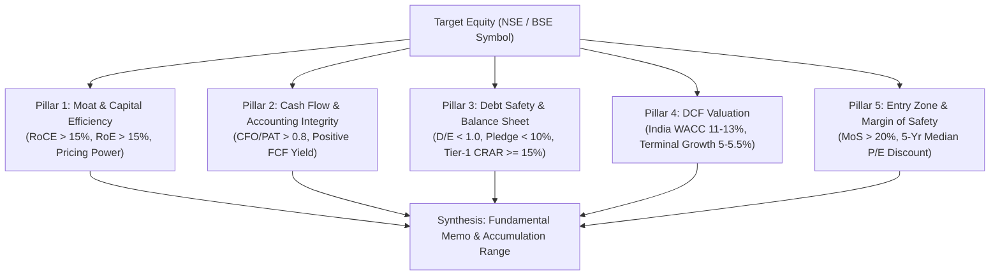

# Indian Fundamental Valuation Skill

## Purpose
The **Indian Fundamental Valuation** skill executes a rigorous 5-pillar fundamental analysis model tailored specifically for Indian equities (NSE and BSE). Adapting core value-investing principles (Buffett, Munger, Duan Yongping) to the Indian regulatory and macro environment, it analyzes economic moats, capital efficiency, corporate governance, balance sheet fortitude, and discounted cash flow (DCF) fair values to determine rational accumulation zones and margins of safety.

## The 5 Pillars of Fundamental Valuation

### Pillar 1: Moat Durability & Capital Efficiency
- **RoCE & RoE**: Sustained Return on Capital Employed (RoCE) $> 15\%$ (ideally $> 18\%$) and Return on Equity (RoE) $> 15\%$ across a full 3-5 year economic cycle.
- **Economic Moat Drivers**: Clear structural competitive advantage:
  - Strong brand pricing power (ability to pass on inflation without losing volume).
  - Network effects or high switching costs in enterprise/software ecosystems.
  - Scale advantages and distribution reach across Tier 2/3 Indian cities.
  - Regulatory licenses or critical infrastructure assets.
- **Governance & Pledge Discipline**:
  - Promoter share pledging MUST be $< 10\%$ (pledge $> 25\%$ triggers an immediate governance red flag).
  - Scrutiny of related-party transactions (RPTs), promoter compensation ratios, and board independence.

### Pillar 2: Cash Flow Discipline & Accounting Integrity
- **CFO / PAT Quality Ratio**: Cash Flow from Operations (CFO) divided by Profit After Tax (PAT) must consistently exceed **0.8** (ideally $> 1.0$).
  - If $\text{CFO} / \text{PAT} < 0.8$ over 3 consecutive years, audit receivables, inventory build-up, and revenue recognition policies for potential earnings manipulation or aggressive accounting.
- **Free Cash Flow (FCF)**: Positive and growing Free Cash Flow ($\text{FCF} = \text{Operating Cash Flow} - \text{Capital Expenditures}$) measured in INR Crores.
- **Reinvestment Efficiency**: High Return on Incremental Invested Capital (ROIC), demonstrating that retained earnings are deployed at rates higher than the cost of capital.

### Pillar 3: Debt Safety & Balance Sheet Fortification
- **Non-Financial Corporates**:
  - Net Debt-to-Equity ($\text{D/E}$) $< 1.0$ (ideally $< 0.5$ or a net-cash fortress balance sheet).
  - Interest Coverage Ratio ($\text{EBIT} / \text{Interest Expense}$) $> 4.0\times$.
  - Working capital stability: avoiding explosive increases in cash conversion cycle days.
- **Financial Institutions & Banks (BFSI)**:
  - Capital to Risk-Weighted Assets Ratio (Tier-1 CRAR) $\ge 15.0\%$.
  - Net Non-Performing Assets ($\text{NNPA}$) $\le 1.5\%$.
  - Provision Coverage Ratio ($\text{PCR}$) $\ge 70.0\%$.
  - Resilient Net Interest Margin ($\text{NIM}$) and low reliance on volatile wholesale certificate-of-deposit funding.

### Pillar 4: DCF Valuation (Calibrated for Indian Macro Dynamics)
- **Indian Discount Rate Calibration**:
  - Risk-free rate ($R_f$): Yield on 10-Year Indian Government Securities (G-Sec) $\approx 6.8\% - 7.2\%$.
  - Equity Risk Premium ($\text{ERP}$): $5.0\% - 5.5\%$ calibrated for emerging market equity risk.
  - Beta ($\beta$): Adjusted 3-year weekly beta against Nifty 50.
  - Cost of Equity ($K_e = R_f + \beta \times \text{ERP}$).
  - Resulting Weighted Average Cost of Capital ($\text{WACC}$) typically ranges between **$11.0\%$ and $13.0\%$**.
- **Terminal Growth Rate**: $g \approx 5.0\% - 5.5\%$, capped at the long-term expected nominal GDP growth of the Indian economy.
- **Growth Projections**: Two-stage DCF model:
  - Stage 1 (Years 1-5): High-growth phase based on audited order books, capacity expansions, and industry growth.
  - Stage 2 (Years 6-10): Fade phase toward terminal growth rate.
- **Relative Valuation Anchor**: Compare forward P/E and PEG ratio ($PEG \le 1.5$ fair; $PEG < 1.0$ high-quality bargain) against the company's 5-year historical median P/E and P/B multiples.

### Pillar 5: Tactical Entry & Margin of Safety
- **Margin of Safety (MoS) Requirement**:
  $$\text{MoS \%} = \frac{\text{DCF Intrinsic Value} - \text{Current Market Price}}{\text{DCF Intrinsic Value}} \times 100$$
  - Standard Compounders: Require **$\text{MoS} \ge 20\%$**.
  - Wide-Moat Monopolies / High-RoCE Franchises: Require **$\text{MoS} \ge 15\%$**.
- **Valuation Verdicts & Price Zones**:
  - `STRONG_ACCUMULATE`: $\text{MoS} \ge 20\%$, Moat Score $\ge 8/10$, PEG $\le 1.5$, trading within dip zone (15-25% below 52-week high).
  - `ACCUMULATE_DIP`: $\text{MoS}$ between $5\%$ and $15\%$, Moat Score $\ge 7/10$.
  - `HOLD`: Fairly valued ($\text{MoS}$ between $-10\%$ and $+5\%$).
  - `OVERVALUED`: Price $> 10\%$ above DCF intrinsic fair value, $PEG > 2.0$, or P/E $> 2\sigma$ above historical median.

## DalalOS BSE-XBRL Integration
For structural accounting depth, the skill integrates with `dalalos` to parse official BSE/NSE XBRL taxonomy filings:
1. **Audited Balance Sheet Line-Items**: Direct validation of Gross Block, Capital Work-in-Progress (CWIP), cash & liquid equivalents, and debt maturities from XBRL balance sheets.
2. **Capex Commitments**: Track disclosed capital expenditure projects, commissioning timelines, and funding sources.
3. **Order Book Audit**: Verify order books, book-to-bill ratios, and execution visibility for EPC, infrastructure, and defense companies from official investor disclosures.
4. **Related Party Transactions (RPTs)**: Machine-read RPT schedules to detect promoter self-dealing, unhedged inter-corporate deposits (ICDs), or royalty fee increases.

## Multi-Tier Data Routing Table
Data ingestion handles market volatility and connectivity fallbacks reliably:

| Fundamental Requirement | Primary Feed | Fallback Tier 1 | Fallback Tier 2 |
|---|---|---|---|
| **Audited Financials & XBRL** | DalalOS (`dalalos:get_financial_statements`) | `indian-market-mcp:get_financial_ratios` | `yfinance-mcp:yfinance_get_financials` |
| **Current Price & Market Cap** | NSE Bhavcopy (`nse-bhavcopy`) / NSE CM (`nse-cm-market`) | `indian-market-mcp:get_quote` | `yfinance-mcp:yfinance_get_quote` (`.NS` / `.BO`) |
| **Historical Price & Median P/E**| `indian-market-mcp:get_historical_data` | Calculated from `nse-bhavcopy` | `yfinance-mcp:yfinance_get_historical_data` |
| **Cash Flow Statements** | DalalOS (`dalalos:get_cash_flow`) | `indian-market-mcp:get_cash_flow` | `yfinance-mcp:yfinance_get_cash_flow` |
| **Order Book & Capex Filings** | DalalOS (`dalalos:get_regulatory_filings`) | NSE Live CM (`nse-cm-market:get_announcements`) | `indian-market-mcp:get_corporate_announcements` |

## Step-by-Step Execution Workflow
1. **Retrieve Financial Statements**: Query DalalOS XBRL disclosures (or fallback feeds) for 5 years of P&L, Balance Sheet, and Cash Flow data.
2. **Audit Moat & Efficiency**: Calculate 3-year average RoCE, RoE, and verify promoter pledge is $< 10\%$.
3. **Audit Earnings Quality**: Verify $\text{CFO} / \text{PAT} > 0.8$ and compute cumulative 5-year Free Cash Flow in INR Crores.
4. **Evaluate Debt Health**: Verify $\text{D/E} < 1.0$, interest coverage $> 4\times$, or BFSI solvency metrics (CRAR $\ge 15\%$, NNPA $\le 1.5\%$).
5. **Model DCF Fair Value**: Calibrate India WACC ($11-13\%$), apply conservative terminal growth ($5-5.5\%$), and derive intrinsic per-share value.
6. **Calculate Margin of Safety**: Benchmark against current market price and 5-year median P/E to output accumulation range.
7. **Synthesize Research Memo**: Emit standard fundamental research memo with thesis strengths, key risks, and fair value targets.

## Strictly Advisory Guardrails
- **Anti-Goal**: Live order placement tools (such as place_order, place_gtt_order, or cancel_order) are forbidden and strictly prohibited.
- **Advisory Only**: The output is an analytical fundamental research memo. No automated order routing occurs; all investment sizing and trade execution decisions remain solely with the human investor.
