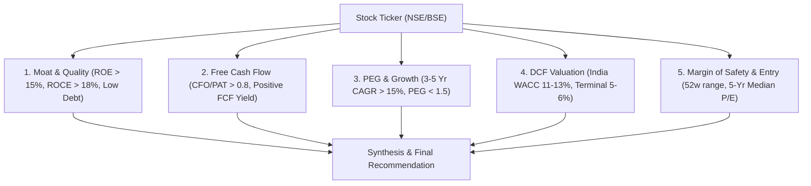

# Indian Fundamental Valuation Skill

## Purpose
Executes a rigorous 5-pillar fundamental analysis on any Indian listed stock (NSE/BSE) to establish whether a company qualifies as a durable long-term compounder, determine intrinsic value via DCF, and compute optimal accumulation price zones.

## The 5 Pillars

## Step-by-Step Procedure

1. **Step 1: Retrieve Financial Statements & Ratios**
   - Query `indian-market-mcp:get_financial_ratios` (ROE, ROCE, P/E, P/B, Debt-to-Equity).
   - Query `indian-market-mcp:get_cash_flow` (Cash from Operations, Capital Expenditure, Free Cash Flow).
   - Query `indian-market-mcp:get_historical_data` (Past 3-5 years price and P/E history).

2. **Step 2: Score Business Moat & Capital Efficiency**
   - Verify 3-year average ROE >= 15% and ROCE >= 18%.
   - Check Net Debt / Equity <= 0.5 (or Tier 1 CRAR >= 15% for BFSI).
   - Evaluate working capital days and cash conversion cycle.

3. **Step 3: Free Cash Flow Quality Check**
   - Calculate `CFO / PAT`. If < 0.8 consistently, flag potential revenue recognition issues or aggressive accounting.
   - Calculate Free Cash Flow = `Operating Cash Flow - CapEx`.

4. **Step 4: DCF & PEG Valuation Modeling**
   - Apply Indian Discount Rate ($WACC = 11.5\% - 12.5\%$).
   - Apply Terminal Growth Rate ($g = 5.0\% - 5.5\%$).
   - Compute DCF intrinsic per share value.
   - Compare with current market price to derive Margin of Safety percentage.

5. **Step 5: Output Research Memo**
   - Generate formatted investment memo with clear accumulation range and stop-loss/invalidation thesis.
