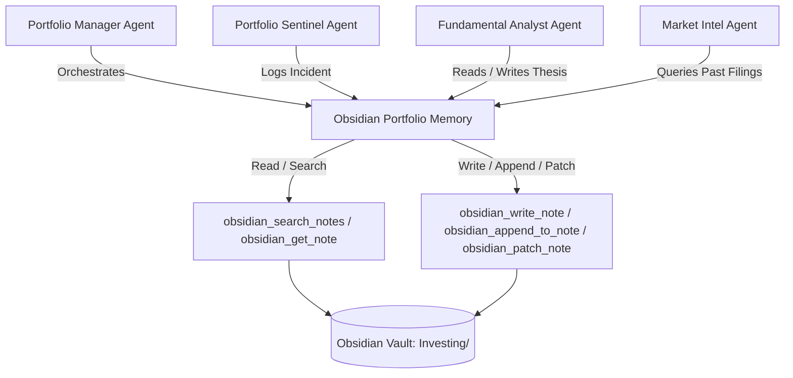

# Obsidian Portfolio Memory Skill

## Purpose
The **Obsidian Portfolio Memory** skill equips autonomous trading and research agents with persistent, human-readable, and searchable long-term memory stored inside a local Obsidian vault via `obsidian-mcp-server`. By anchoring investment theses, periodic mutual fund audits, and risk incident journals in markdown notes, this skill prevents cross-session amnesia, ensures auditability, and enforces discipline against panic selling or thesis drift.

## Vault Folder Architecture
All persistent investment notes are structured within the root `Investing/` vault directory:

```
Investing/
├── Theses/                 # Long-term investment theses for individual equities
│   ├── RELIANCE-thesis.md
│   ├── TCS-thesis.md
│   └── <SYMBOL>-thesis.md
├── Funds/                  # Health audits and factor allocations for MFs & ETFs
│   ├── Parag-Parikh-Flexi-Cap-review.md
│   └── <SCHEME_NAME>-review.md
└── Alerts/                 # Incident journal of adverse events, shocks, and alerts
    ├── 2026-11-01-INFY-alert.md
    └── YYYY-MM-DD-<SYMBOL>-alert.md
```

### 1. `Investing/Theses/`
- **File Naming**: `<SYMBOL>-thesis.md` (e.g., `TCS-thesis.md`, `HDFCBANK-thesis.md`).
- **Scope**: Comprehensive investment rationale for core equity holdings. Captures business model moat, the 5-Pillar Scorecard (RoCE, Moat, Governance, Debt, Valuation), growth catalysts, pre-committed invalidation criteria, and quarterly performance audit logs.
- **Template**: `templates/obsidian/stock-thesis-template.md`.

### 2. `Investing/Funds/`
- **File Naming**: `<SCHEME_NAME>-review.md` (e.g., `Parag-Parikh-Flexi-Cap-review.md`).
- **Scope**: Periodic diagnostics for direct mutual fund schemes and ETFs. Tracks trailing and rolling returns against Total Return Benchmarks, risk-adjusted metrics (Sharpe, Sortino, Downside Capture), fund manager tenure, Total Expense Ratio (TER) trends, and AUM liquidity/cash drag.
- **Template**: `templates/obsidian/mf-etf-review-template.md`.

### 3. `Investing/Alerts/`
- **File Naming**: `YYYY-MM-DD-<SYMBOL>-alert.md` (e.g., `2026-11-01-INFY-alert.md`).
- **Scope**: Chronological incident log recording market anomalies, price drops, forensic flags, SEBI surveillance actions, or credit downgrades. Documents corporate action verification status (splits/bonuses), capital exposure, fundamental assessment, and advisory next steps.
- **Template**: `templates/obsidian/risk-alert-journal-template.md`.

## Standard Obsidian MCP Interaction Patterns
Agents interact with the user's Obsidian vault exclusively through the exact tool identifiers provided by `obsidian-mcp-server`:
- `obsidian_get_note`: Reads markdown content and parsed frontmatter attributes for a specific note.
- `obsidian_write_note`: Creates a new note or replaces note content using structured markdown templates.
- `obsidian_search_notes`: Queries notes across the vault by symbol, title, or keyword search.
- `obsidian_append_to_note`: Appends new sections, quarterly audit entries, or follow-up notes without overwriting existing content.
- `obsidian_patch_note`: Surgically replaces or patches targeted blocks, frontmatter fields, or alert statuses.

### 1. Searching Notes (`obsidian_search_notes`)
Before initiating deep valuation analysis, rebalancing recommendations, or responding to market volatility, the agent must check if an existing note exists:
- Query by ticker symbol or scheme keyword:
  ```json
  {
    "query": "TCS"
  }
  ```
- Evaluates search results to locate relevant theses in `Investing/Theses/`, fund reviews in `Investing/Funds/`, or prior risk records in `Investing/Alerts/`.
- Prevents redundant note creation and ensures historical context is incorporated.

### 2. Reading Notes (`obsidian_get_note`)
When a holding is identified for review or monitoring:
- Read note content by path or query:
  ```json
  {
    "path": "Investing/Theses/TCS-thesis.md"
  }
  ```
- Extracts frontmatter attributes (`avg_buy_price`, `moat_type`, `target_exit_price`, `stop_loss_level`) and invalidation criteria.
- Feeds historical purchase assumptions into current price evaluations to detect thesis violations.

### 3. Creating & Writing Notes (`obsidian_write_note`)
When a new stock position is entered, a mutual fund added, or an adverse incident flagged:
- Creates a new markdown document using the canonical templates in `templates/obsidian/`:
  ```json
  {
    "path": "Investing/Theses/INFY-thesis.md",
    "content": "---\nsymbol: \"INFY\"\ncompany_name: \"Infosys Limited\"\n..."
  }
  ```
- Ensures all mandatory YAML frontmatter properties and structured markdown headings are strictly populated.

### 4. Appending to Notes (`obsidian_append_to_note`)
When new quarterly financial results are released or ongoing audit logs are updated:
- Appends historical entries to the note without destroying previous records:
  ```json
  {
    "path": "Investing/Theses/INFY-thesis.md",
    "content": "\n| 2026-Q3 | 1,840.00 | ₹42.50 | 18.2x | Thesis on track; cloud revenue +18% YoY | Arun |\n"
  }
  ```
- Appends quarterly review entries to the `Quarterly Audit Log` table, preserving the immutable trail of previous analyses.

### 5. Patching Notes (`obsidian_patch_note`)
When updating specific alert statuses or frontmatter fields:
- Surgically patches target lines or metadata blocks:
  ```json
  {
    "path": "Investing/Alerts/2026-11-01-INFY-alert.md",
    "search": "status: \"TRIGGERED\"",
    "replace": "status: \"RESOLVED\""
  }
  ```
- Updates alert status in `Investing/Alerts/` from `TRIGGERED` to `INVESTIGATING` or `RESOLVED`.

## Multi-Agent Memory Coordination Workflow



1. **Portfolio Sentinel Integration**:
   - On detecting price drawdown $>20\%$, checks `Investing/Theses/<SYMBOL>-thesis.md` for pre-defined stop-loss levels and invalidation criteria.
   - Logs new market shock or forensic flag to `Investing/Alerts/YYYY-MM-DD-<SYMBOL>-alert.md`.
2. **Fundamental Analyst Integration**:
   - Retrieves historical 5-Pillar Scorecards before re-evaluating earnings reports.
   - Appends quarterly earnings review to `Quarterly Audit Log` in `Investing/Theses/<SYMBOL>-thesis.md`.
3. **Portfolio Manager Integration**:
   - Reads all active theses during periodic rebalancing to verify whether capital allocation conforms to thesis conviction.
   - Flags holdings that have reached their target exit price or breached invalidation rules.

## Strictly Advisory Guardrails
- **Anti-Goal**: Live order placement tools (such as place_order, place_gtt_order, or cancel_order) are forbidden and strictly prohibited.
- **Advisory Only**: All notes, theses, and alert logs created or retrieved by this skill are research artifacts and cognitive aids. No automated trade execution is conducted; all portfolio adjustments, buy/sell decisions, and order modifications remain strictly manual actions executed solely by the human investor.
